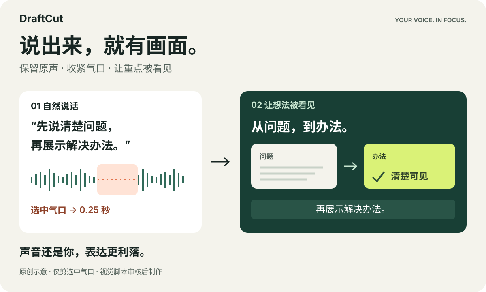
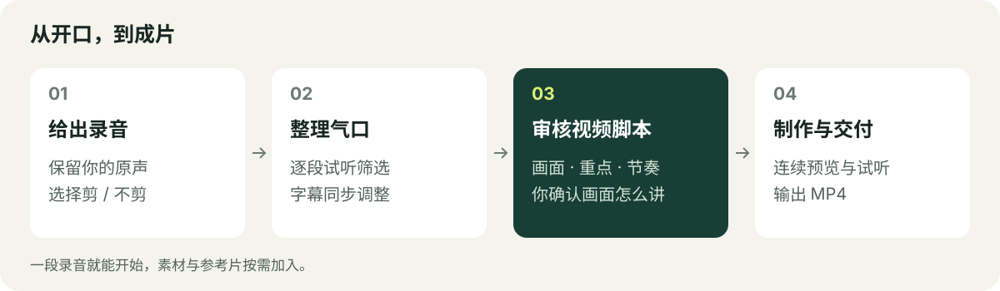

**简体中文** · [English](README_EN.md)

# DraftCut

## 只管说，让好想法变成好视频。

把录音交给你的 Agent。DraftCut 保留你的声音，整理口头禅、口误和重说，让字幕、图解和画面跟着你的表达展开，做成一条精炼、精美的口播视频。

**一段录音就能开始。** 不用先拍人物视频、做字幕，或在时间线上逐帧摆素材。

[开始制作](#开始制作) · [看看效果](#让观众看懂你在说什么) · [工作流程](#从开口到成片)



我们的愿景：让口播视频的人工剪辑投入缩短 **100 倍**，把时间还给表达。这个目标尚未经基准验证。

## 还是你的声音，表达更利落

录音时，你可以慢慢想、自然说。成片时，让讲述更紧凑。

Agent 通读并试听你的表达，整理口头禅、口误、改口、冗余重说和停顿，留下完整自然的表达、思考与强调的节奏。先看精炼口播稿和修改依据；你确认后，再把原声剪成同一版本，字幕跟着声音走。

## 让观众看懂你在说什么

讲步骤，就让步骤逐个出现。讲差异，就把对象放在一起比较。讲产品，就让演示跟上讲解。

你可以给一份素材、一条参考片，也可以只给录音，让 Agent 从内容设计画面。有人物素材，就把人物放进故事；没有，也能用图解和动态文字讲清楚。


作者既有成片片段，**6 倍速、无声**。[示例说明](docs/getting-started.md#examples-and-validation)

[再看一个图解示例](assets/examples/embodied-correction-6x.gif) · [作者的更多视频](https://www.xiaohongshu.com/user/profile/5b40fe744eacab72c9f480ef)

## 在你习惯的 Agent 里使用

DraftCut 是一份 Agent Skill，支持具备本地文件读写、命令执行和视听能力的 Agent。让它读懂制作方法，再调用本地工具完成视频。

推荐模型：**Opus 5.5、ChatGPT 6 Astra、Kimi k3**。

## 开始制作

### 1. 准备一次环境

需要 **Python 3.10+、Node.js 22+、FFmpeg/ffprobe 和本机完整 Google Chrome**。在 macOS/Linux 终端执行：

```bash
git clone https://github.com/PoetCoderJun/DraftCut.git
cd DraftCut
python3 -m venv .venv
. .venv/bin/activate
python3 -m pip install -r requirements.txt
npm ci
```

让 Agent 在这个目录工作，使用这里的 Python 环境。也可以[安装到现有 Agent](docs/getting-started.md#skill-installation)。

内置转写使用 DashScope，通过安全环境配置提供 `DASHSCOPE_API_KEY`。**音频会上传到该服务，可能产生费用，需要你明确授权**。密钥不要写进提示词或仓库。[配置说明](docs/getting-started.md#transcription-configuration-and-consent)

### 2. 给它录音，说出你想要的效果

把路径换成你的真实文件，向 Agent 发送：

```text
读取当前目录的 SKILL.md，使用 DraftCut。
把 /绝对路径/我的录音.wav 做成一条竖屏口播视频。
保留我的声音，精剪口头禅、口误、重说和冗余停顿。
先给我口播稿与修改依据，等我审核批准后生成精炼原声。
让重点和图解跟着讲解展开。先把视频导演脚本交给我审核，确认后再制作。
输出到 /绝对路径/本次视频输出（新的空目录）。
```

有素材或参考片就一并提供。已有口播视频，也可以[使用其中的原声和画面](docs/getting-started.md#video-input)。

### 3. 确认画面怎么讲，收下成片

先审核口播稿，再审核视频导演脚本。两次确认后，Agent 继续制作、预览和导出 MP4。可编辑工程保留，方便继续修改。[审核操作](docs/approvals.md)

## 从开口到成片



先整理声音，再决定画面怎么讲。导演脚本把构图、重点、素材与节奏放在一起，让你在制作前看清整条视频的走向。批准后，Agent 连续完成制作、检查与交付。

**口播稿审核 → 视频脚本审核 → 成片。** 每次批准对应具体版本；修改内容后重新审核。[审核说明](docs/getting-started.md#what-you-review)

[安装与使用](docs/getting-started.md) · [工程与验证](docs/harness-case-study.md) · [集成范围与兼容](docs/audio-first-migration.md) · [第三方许可](THIRD_PARTY_NOTICES.md)

DraftCut 原名 MotionTalk；旧项目需[迁移后重新审核](docs/audio-first-migration.md)，原有素材与工程可保留。按 [CC BY-NC-SA 4.0](LICENSE.md) 提供，限非商业使用；商业使用需事先取得书面授权。

<!-- Compatibility anchors for previously published README links. -->
<a id="quickstart"></a>
<a id="creator-work"></a>
<a id="what-you-get"></a>
<a id="setup-and-data-path"></a>
<a id="checks-and-limitations"></a>
<a id="engineering-and-local-checks"></a>
<a id="compatibility-and-licenses"></a>
<a id="core-capabilities"></a>
<a id="development"></a>
<a id="first-run"></a>
<a id="install"></a>
<a id="just-tell-the-agent-what-you-want"></a>
<a id="license"></a>
<a id="reference-themes"></a>
<a id="参考主题"></a>
<a id="和-ai-说几句话就行"></a>
<a id="安装"></a>
<a id="开发验证"></a>
<a id="核心能力"></a>
<a id="检查与限制"></a>
<a id="第一次使用"></a>
<a id="许可"></a>
