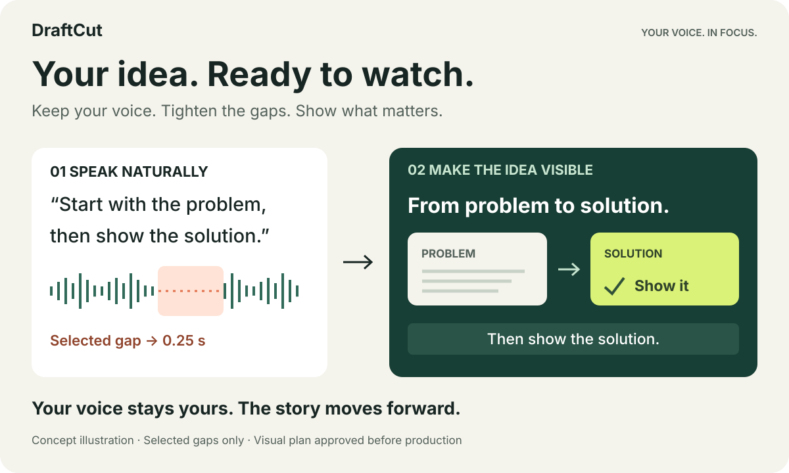
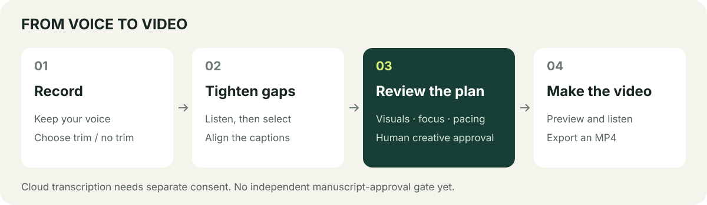

[简体中文](README.md) · **English**

# DraftCut

## Speak your ideas. Give them a screen.

Give your Agent a recording. DraftCut keeps your voice, tightens selected breath gaps, and brings your ideas to life with captions, diagrams and motion—a concise, polished spoken video.

**Start with one audio file.** No presenter footage, prepared subtitles or manual timeline layout required.

[Get started](#get-started) · [See the visual possibilities](#help-people-see-what-you-mean) · [How it works](#from-recording-to-finished-video)



Our ambition: **100× less hands-on editing** for spoken videos, so you can spend more time expressing ideas. This is a product goal, not a measured guarantee. No comparative benchmark has established it; time depends on the material, Agent, human review and rendering environment.

## Still your voice. A tighter delivery.

Pausing to find your next thought is natural. The finished video can move a little faster.

You decide whether to trim breath gaps. The Agent uses word timings and actual listening to select suitable intervals, keeping **0.25 seconds** in each selected gap by default. Meaningful pauses stay. Choose no trimming to preserve the original timeline.

The voice comes from your recording. Captions follow the same edited timeline, while diagrams, demonstrations and animated text bring out the ideas. **The integrated editing scope is breath gaps.** Semantic removal of fillers, mistakes and retakes is not yet integrated; this workflow does not automatically rewrite your speech.

## Help people see what you mean

Explain a process with unfolding steps. Compare ideas side by side. Show a product as you describe it. Bring your own materials and a reference video—or start with just your voice and let the Agent design around the content.

| What you are explaining | How the visuals can help |
| --- | --- |
| A complex idea | Diagrams reveal the relationships as the argument develops |
| A method or workflow | Steps, screenshots and screen recordings follow the explanation |
| A personal perspective | Key phrases and supporting footage shape the rhythm; optional presenter footage keeps you in frame |


An existing creator video, 00:39–01:27, shown **6× faster without sound**. It illustrates visual possibilities, not end-to-end validation of the current recording-to-video workflow.

[Another diagram example](assets/examples/embodied-correction-6x.gif) · [More creator videos](https://www.xiaohongshu.com/user/profile/5b40fe744eacab72c9f480ef)

## Work in the Agent you already use

DraftCut is an Agent Skill: a production method the Agent reads and executes with local tools. Agents that can read files, run commands, inspect visuals and actually listen to audio can attempt this workflow. We have not verified every Agent.

The project author recommends **Opus 5.5, ChatGPT 6 Astra and Kimi k3** as creative-model choices. These are recommendations, not compatibility certifications; model availability and tool support depend on your platform. A chat-only environment cannot complete local production on its own.

## Get started

### 1. Set up once

You need **Python 3.10+, Node.js 22+, FFmpeg/ffprobe and a local full Google Chrome**. In a macOS/Linux terminal:

```bash
git clone https://github.com/PoetCoderJun/DraftCut.git
cd DraftCut
python3 -m venv .venv
. .venv/bin/activate
python3 -m pip install -r requirements.txt
npm ci
```

Work with your Agent in this directory using this Python environment. An alternative [Skill installation](docs/getting-started.md#skill-installation) is also available.

Built-in transcription uses DashScope. Supply `DASHSCOPE_API_KEY` through your Agent's secure environment configuration. **Audio is uploaded to that service and charges may apply; explicit authorization is required.** Keep keys out of prompts and Git. See [configuration, video input and troubleshooting](docs/getting-started.md).

### 2. Give it a recording and a direction

Replace these paths with your real files, then send your Agent:

```text
Read SKILL.md in the current directory and use DraftCut.
Turn /absolute/path/my-recording.wav into a vertical spoken video.
Keep my voice. Trim only breath gaps selected after listening; do not remove spoken content.
Use key phrases and diagrams to support the explanation.
Show me the video director script for approval before production.
Write to /absolute/path/new-video-output, a new empty directory.
```

Add materials or a reference video if you have them. Neither is required. For an existing talking video, ask the Agent to use its original audio and specify whether to keep the presenter footage as a visual asset. See [audio extraction](docs/getting-started.md#video-input).

### 3. Approve the visual story. Get your video.

The Agent works through the publishing format, idea and style with you, then delivers a reviewable video director script. Once approved, it continues through captions, visual production, preview, checks and MP4 export. The editable project stays available for revisions.

## From recording to finished video



1. **Bring a recording.** Choose whether to trim breath gaps. Authorize upload and possible charges before cloud transcription.
2. **Prepare the audio.** Transcribe and review content; listen to candidate gaps, edit only selected intervals and align captions.
3. **Approve the video script.** Review how the screen tells the story: composition, emphasis, assets, pacing and timing. The default review covers `MG导演脚本.md` and its companion plan.
4. **Produce and check.** The Agent builds the visuals, previews continuously, listens, exports and validates the deliverable.

There is currently one default human creative-approval gate: **the video director script**. Breath selection and cloud-service authorization are earlier decisions. Content review is part of audio preparation; an independent “approved spoken manuscript” gate is not implemented. To review the full transcript first, explicitly ask your Agent to pause for your confirmation.

## Go further

[Setup and usage](docs/getting-started.md) · [Engineering and validation](docs/harness-case-study.en.md) · [Integration and compatibility](docs/audio-first-migration.md) · [Third-party notices](THIRD_PARTY_NOTICES.md)

Transcription can mishear words; cuts need listening and visuals need continuous review. A successful export alone does not establish content, sound or creative quality. The 100× goal is not a performance guarantee. Engineering docs explain what the checks do and do not cover.

DraftCut was previously MotionTalk. Existing project formats remain compatible; new installations use the `draftcut` Skill name. Licensed for non-commercial use under [CC BY-NC-SA 4.0](LICENSE.md). Commercial use requires prior written permission; third-party materials retain their own licenses.

<!-- Compatibility anchors for previously published README links. -->
<a id="quickstart"></a>
<a id="creator-work"></a>
<a id="what-you-get"></a>
<a id="setup-and-data-path"></a>
<a id="checks-and-limitations"></a>
<a id="engineering-and-local-checks"></a>
<a id="compatibility-and-licenses"></a>
<a id="core-capabilities"></a>
<a id="development"></a>
<a id="first-run"></a>
<a id="install"></a>
<a id="just-tell-the-agent-what-you-want"></a>
<a id="license"></a>
<a id="reference-themes"></a>
<a id="参考主题"></a>
<a id="和-ai-说几句话就行"></a>
<a id="安装"></a>
<a id="开发验证"></a>
<a id="核心能力"></a>
<a id="检查与限制"></a>
<a id="第一次使用"></a>
<a id="许可"></a>
